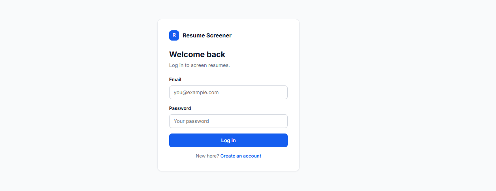
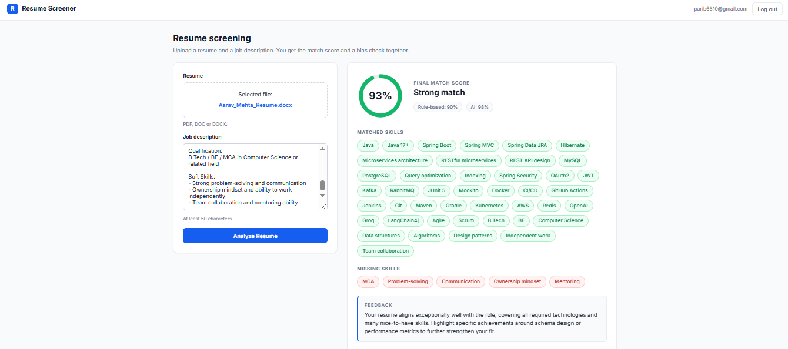
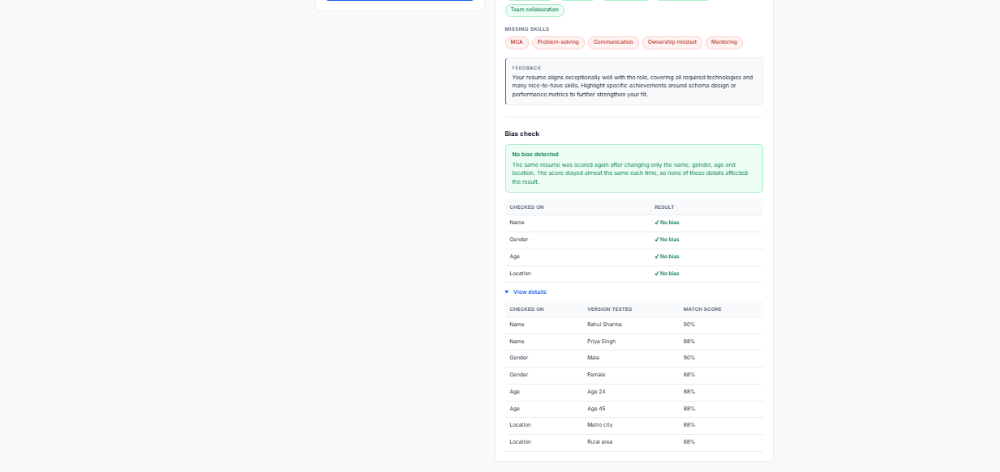

# AI-Powered Resume Screener with Bias Detection

## Project Description
A web application that screens resumes against a job description using a hybrid of rule-based matching and LLM-based analysis, and checks whether the scoring is biased by candidate name.

## Problem Statement
Manual resume screening is slow and can be affected by unconscious bias. Many AI screeners also give inconsistent scores and offer no way to verify fairness. This project provides consistent, explainable scoring along with a built-in bias check.

## Objectives
- Extract text from PDF, DOC and DOCX resumes
- Extract required skills from a job description
- Score resumes with a hybrid (rule-based + AI) approach
- Detect name-based bias by comparing scores for identical resumes with different names
- Provide secure signup/login with email OTP verification

## Technologies and Tools
- Java 21, Spring Boot, Maven
- Spring Security, Spring Data JPA, MySQL
- Apache PDFBox, Apache POI
- LangChain4j + Groq API (openai/gpt-oss-120b)
- Brevo (email API for OTP)
- HTML, CSS, JavaScript (frontend)

## Key Features
- Resume upload (.pdf / .doc / .docx)
- Job-description skill extraction (deterministic, temperature 0)
- Hybrid scoring: 60% rule-based fuzzy matching + 40% AI score
- Bias Check tab: score variance across different candidate names
- Signup / Login with OTP email verification (BCrypt password hashing)

## System Requirements
- JDK 21
- Maven 3.9+
- MySQL 8+
- Internet connection (Groq and Brevo APIs)

## Installation
```bash
git clone https://github.com/laxmibansal346/resume-screener.git
cd resume-screener/enterprise-resume-screener
```

## Database Configuration
Create the database (tables are created automatically by JPA):
```sql
CREATE DATABASE resume_screener_db;
```
Default connection: `localhost:3306`, user `root`.

## Environment Variables
Set these before running (never commit them):

| Variable | Purpose |
|---|---|
| `GROQ_API_KEY` | Groq API key |
| `MYSQL_PASSWORD` | MySQL root password |
| `BREVO_API_KEY` | Brevo API key (OTP emails) |
| `MAIL_FROM` | Verified sender email in Brevo |

## Steps to Run
```bash
mvn spring-boot:run
```
Open http://localhost:8081, sign up, verify the OTP, then use the Resume Analysis and Bias Check tabs.

## Screenshots
Add images in the `screenshots/` folder and link them here:





## Team Members
| Name | Enrollment No. |
|---|---|
| Laxmi | BETN1AI25226 |
| Divyansh Shrivastava | BETN1AI25082 |

**Guide:** Mrs. Vani Agrawal — ITM University, Gwalior (SOET)
